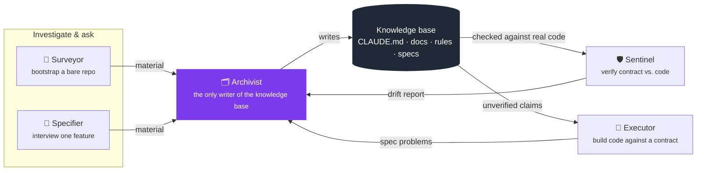

<div align="center">

# Delta

**A living-documentation methodology for AI coding agents.**

[](https://claude.com/claude-code)
[]()
[]()

</div>

---

Most project context lives in one of two bad places: a person's head, or an ever-growing history of decisions that costs more to read than it's worth. **Delta** treats documentation as a set of **living contracts** instead — files that describe what is true *right now*, edited in place as things change, never appended to as a log. Superseded content is simply gone; git history is already the record of what used to be true.

This repository *is* the harness: the skills, rules, and templates that implement Delta, packaged for [Claude Code](https://claude.com/claude-code) (`.claude/`). Drop that folder into a project and its agent gains five new capabilities: four for creating and maintaining that project's documentation, and one for building code against it.

## Contents

- [Delta in plain words](#delta-in-plain-words)
- [The five-role pipeline](#the-five-role-pipeline)
- [What the knowledge base looks like](#what-the-knowledge-base-looks-like)
- [Using this repo](#using-this-repo)
- [Repository layout](#repository-layout)
- [Non-goals](#non-goals)

---

## Delta in plain words

Think of Delta as a small team of assistants that keep a project's notes honest, so the agent never has to guess how your project works.

- **You talk, they do the paperwork.** You say what you want in normal sentences ("spec out checkout", "implement it", "is it still accurate?"). The right assistant picks it up; you never have to remember file names or formats.
- **One note per feature.** Each feature gets a short *contract* (its `spec.md`) that says what it must do and what must always be true. It describes the present, not the history: when things change, the contract is edited, not appended to.
- **The contract drives the code.** The agent reads the contract before touching a feature, writes tests from its claims, then writes the code to satisfy them.
- **Drift gets caught.** After the code changes, a check compares the contract to what the code really does and tells you where they disagree.

### A typical week

1. **Day one, once per project:** *"bootstrap this repo with Delta"*. The agent reads your codebase (or asks a few questions if it's empty) and writes the project's overview and a `CLAUDE.md` that points to everything.
2. **New feature:** *"let's spec out invoices"*. You get asked a handful of targeted questions: what it's for, what must never break, what's still undecided. The answers become `invoices.spec.md`.
3. **Build it:** *"implement the invoices slice"*. The agent shows a plan built from the claims not yet proven. You approve it, and it writes the tests first, then the code.
4. **Later, after changes:** *"check invoices for drift"*. You get a short table: what still holds, what was broken, what can't be verified.
5. **Anything else worth remembering:** *"we decided to always use UTC, write that down"*. It lands in the right place, in the right shape.

You decide at every step that matters: the plan is yours to approve, and nothing in the knowledge base is changed behind your back.

### Required and optional rules

Delta splits its rules in two:

- **Required** (`.claude/rules/`): the ones Delta itself needs to work, such as how the knowledge base is edited, when something deserves a spec, how much context it may cost, and the lean-change rule that keeps code changes small.
- **Optional** (the surveyor's rule catalog): conventions that depend on your language or team habits, such as DDD layering, Python and TypeScript idioms, and English-only code. When you bootstrap a project, the surveyor proposes the ones that match your repo and writes only the ones you confirm into your project's `.claude/rules/`; the rest cost you nothing.

---

## The five-role pipeline

Delta enforces "every piece of context lands in the right shape, every time" with five narrow, single-responsibility skills rather than one do-everything assistant. Bootstrap and interview investigate and ask; verify checks; **only the write stage commits a change to the knowledge base**; the optional build stage writes application code and tests, and never the knowledge base:



| Skill | Role | Its reason to change | Writes to the knowledge base? |
|---|---|---|:---:|
| 🧭 **Surveyor** | Bootstraps a repo that has no knowledge base yet — scans the codebase (or interviews, if greenfield) breadth-first | "did the project get oriented fast and accurately" | ❌ hands off to Archivist |
| 📝 **Specifier** | Gathers what code alone can't answer for one feature — intent, invariants, open questions, UI states/interactions | "did we ask the right questions and find the right conflicts" | ❌ hands off to Archivist |
| 🗂️ **Archivist** | Lands material into the correct artifact shape — a doc, a rule, an agent, a skill, or a feature's contract | "does the artifact land in the right shape" | ✅ the sole writer |
| 🛡️ **Sentinel** | Verifies whether an already-written contract still holds against the real implementation | "does the implementation still match its contract" | ❌ reports drift, hands corrections back |
| 🔨 **Executor** | Implements a slice against its contract: derives the work from the claims not yet verified, proposes it for approval, then writes tests first and the code | "does the code now satisfy the contract, with tests that say so" | ❌ writes code and tests; hands spec problems back |

> A hand-edit to any of these files skips the pipeline and is exactly the kind of drift Delta exists to prevent — the one exemption is a trivial, already-settled fix (a typo, a stale command).

Full step-by-step instructions for each skill live in `.claude/skills/<name>/SKILL.md`.

---

## What the knowledge base looks like

Once bootstrapped, a project's Delta knowledge base has three layers — a router, a curated reference, and per-feature contracts:

```
CLAUDE.md                      router — orients a session fast, points at everything else
.claude/docs/                  curated, project-wide reference (always 6 files)
   ├─ overview.md                 vision, scope, domain concepts
   ├─ modules.md                  cross-component flows and non-obvious behavior
   ├─ structure.md                stack, topology, infrastructure, cross-cutting patterns
   ├─ database.md                 data model + persistence infrastructure
   ├─ expertise.md                non-obvious mechanisms/concepts the project leans on
   └─ approach.md                 build philosophy, roadmap, done criteria
.claude/rules/<topic>.md       conventions auto-loaded when matching files are touched
.claude/agents/<name>.md       bounded, repeatable subagents with their own tools/context
services/<service>/deltas/     per-feature living contracts ("slices")
   ├─ <slice>.spec.md             logic-layer contract: intent, invariants, acceptance criteria
   └─ <slice>.design.md           presentation-layer contract (only if the slice has a UI)
```

A **slice** is a bounded feature or capability — sized the way a bounded context would be, not a source file. Two slices whose contracts keep changing together for the same reason are really one slice wearing two names. It's scoped to a capability, never to an architecture layer — a slice never gets split into a domain-logic spec, an application-orchestration spec, and an infrastructure spec for the same capability; that treats "layer" as if it were the capability boundary. A slice's contract is the only artifact Delta keeps for it — there's no roadmap file; moving from a finished contract to code is ordinary implementation work, never a second knowledge-base artifact.

Every doc/rule stays self-contained and free of volatile references — no citing a specific file path or function name as proof a convention exists, since that breaks the moment something is renamed. A `spec.md`/`design.md`, by contrast, is expected to name the real implementation, since that's the whole point of a contract checked against it.

---

## Using this repo

This repo has no application source of its own — it *is* the reusable harness.

```
1. copy .claude/ into your project
2. "bootstrap this repo with Delta"        → Surveyor writes CLAUDE.md + .claude/docs/*
3. "let's spec out <feature>"              → Specifier interviews, Archivist writes <slice>.spec.md
4. "implement <feature>"                   → Executor plans from the unverified claims, then builds
5. "check <feature> for drift"             → Sentinel verifies the contract against the code
6. anything else worth documenting         → Archivist, directly
```

1. **Copy** `.claude/` into the target repo.
2. **Bootstrap** — *"bootstrap this repo with Delta"* — invokes 🧭 **Surveyor**, which produces `CLAUDE.md` and fills in the six `.claude/docs/*` files from what it finds in the codebase (or from a short interview, if the repo is greenfield).
3. **Spec a feature** — invokes 📝 **Specifier**, which investigates and interviews, then hands off to 🗂️ **Archivist** to write `<slice>.spec.md` (and `<slice>.design.md` for anything with a UI).
4. **Build** — *"implement the checkout slice"* — invokes 🔨 **Executor**, which computes the work from the spec's claims that aren't verified yet, proposes the plan for your approval, then writes tests first and the code. It edits source and tests only, never the knowledge base.
5. **Verify** after implementing — invokes 🛡️ **Sentinel**, which checks the spec's invariants against the real code — running the test each one links to, when it has one — and reports drift as a compact table:

   `Holds` · `Violated` · `Unverified` · `Gone` · `Conflict`

6. **Anything else** — a convention, a subagent, an update to `CLAUDE.md` — ask directly; that routes to 🗂️ **Archivist**.

---

## Repository layout

| Path | Purpose |
|---|---|
| `.claude/skills/` | The five skills' instructions (`SKILL.md`) and their fill-in templates (`references/`), including the surveyor's optional rule catalog (`references/catalog/`) |
| `.claude/rules/` | The required rules: editing conventions for the knowledge base (route through the matching skill, don't hand-edit), delta scope, context budget and lean code changes (applied to every source change, spec or not) || `.claude/agents/`, `.claude/docs/` | Empty/skeleton here — populated per-project once bootstrapped, not part of the harness itself |
| `.claude/settings.json` | Baseline permission allow/deny list for Claude Code sessions |

## Non-goals

- Delta does not keep an append-only decision log. When two sources disagree, the conflict is resolved explicitly and the resolution becomes the corrected text — nothing else is kept beyond that.
- Sentinel only checks a slice's `spec.md`/`design.md` against the code — it doesn't audit `.claude/docs/*` or `.claude/rules/*` for drift.
- Only the optional Executor writes application code, always from a plan you approved and derived from a spec, and it never touches the knowledge base. Delta manages context *about* a codebase first, and doesn't replace ordinary coding with no spec behind it.
