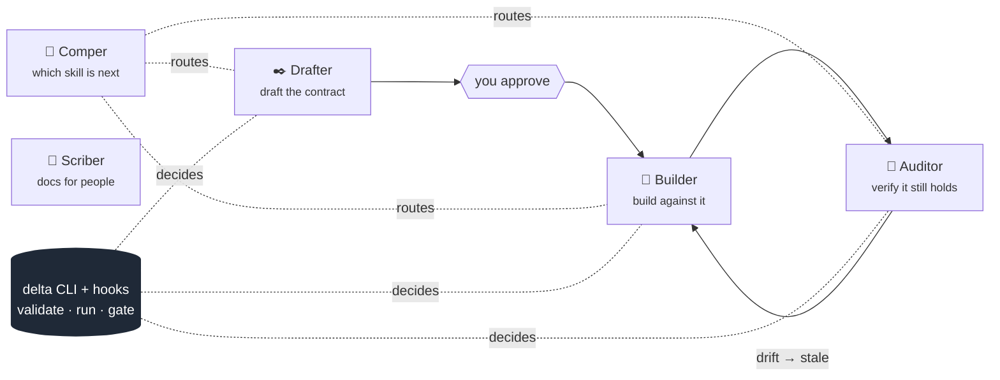

<div align="center">

# Delta

**A verifiable contract between what your project says it does and what its code does.**

[](https://claude.com/claude-code)
[]()
[]()

</div>

---

Most project context lives in one of two bad places: a person's head, or an ever-growing history of decisions that costs more to read than it's worth. **Delta** treats documentation as a set of **living contracts** instead: files that describe what is true *right now*, edited in place as things change, never appended to as a log. Superseded content is simply gone; git history is already the record of what used to be true.

What Delta adds on top is that the contract can be **checked**. Every claim has a stable ID and says how it is verified, the code the agent writes is held to the contract, and when the code and the contract drift apart, you find out instead of the agent silently believing a stale document.

Delta is a small deterministic CLI (`delta`, written in Go), a set of Claude Code hooks, and five skills on top. To use it on a project, read [INSTRUCTIONS.md](INSTRUCTIONS.md).

## Contents

- [The idea](#the-idea)
- [Five skills and a CLI](#five-skills-and-a-cli)
- [The life of a slice](#the-life-of-a-slice)
- [What a contract looks like](#what-a-contract-looks-like)
- [What delta installs in a project](#what-delta-installs-in-a-project)
- [The hooks](#the-hooks)
- [The commands](#the-commands)
- [Rules](#rules)
- [What Delta promises, and what it doesn't](#what-delta-promises-and-what-it-doesnt)
- [Repository layout](#repository-layout)
- [Development](#development)
- [Non-goals](#non-goals)
- [Acknowledgments](#acknowledgments)

---

## The idea

**The model proposes, the code decides.** Everything that can be a rule (the shape of a spec, the state of a feature, whether a claim holds) is enforced by a program and hooks, not by a prompt that the model may or may not follow. The model is kept for what is genuinely creative or ambiguous: interviewing, drafting claims, planning, writing code.

- **One contract per feature.** Each feature (a *slice*) gets a short spec that says what it must do and what must always be true. It describes the present, not the history.
- **Claims are checkable.** Every claim has an ID and a verification tag. `delta check` runs the linked command and reports `Holds`, `Violated` or `Unverified`. `Unverified` never pretends to be `Holds`.
- **The contract drives the code.** Tests cite the claim they prove, and when the code would have to contradict a claim, the agent stops and raises a spec question instead of deciding silently.
- **Drift is loud.** When code a contract depends on changes, the slice is marked `stale` until it is verified again.
- **You decide at the expensive points.** Approving a contract is yours, the plan is yours to approve before anything is built, and nothing in the knowledge base is changed behind your back.

## Five skills and a CLI



| Skill | What it does | Slice state it owns |
|---|---|---|
| 🧭 **Comper** `/comper [slice]` | Reads `delta status` and sends a plain request to the right skill. Called alone, it says which skill comes next and does nothing else | none |
| ✒️ **Drafter** `/drafter <slice>` | Interviews you about one feature, investigates the real code and drafts the claims with `delta spec write` | up to `draft`; you move it to `approved` |
| 🔨 **Builder** `/builder <slice>` | Plans from the claims not yet verified, you approve the plan, then it writes tests first and the code, and links each test to its claim. Never edits the contract | `approved` → `built` → `verified` |
| 🔏 **Auditor** `/auditor <slice>` | Verifies the contract against the code. The deterministic part runs commands; a model reads only the claims that have no command. Reports, never edits | reports on `built`, `verified` and `stale` |
| 📖 **Scriber** `/scriber <doc>` | Writes the four docs for people (`overview`, `structure`, `expertise`, `approach`) from what the project shows and what you tell it | none: it sits outside the contract loop |

You can speak plainly ("add refunds to billing") and Comper routes it, or call a skill by name. You never type `delta` commands to do the work; the skills run them.

The `delta` CLI is what makes the state machine real: it validates specs, is the only writer of the knowledge base, runs verification, tracks drift, measures the context budget, and answers the Claude Code hooks. It does not depend on Claude Code; the hooks are a thin adapter on top.

## The life of a slice

| State | Meaning | What moves it forward |
|---|---|---|
| `draft` | The contract is written and waits for review | `delta approve <slice>`, run by you |
| `approved` | The contract is accepted; the code can be built | `delta built <slice>`, run by Builder |
| `built` | The code and tests exist | `delta check <slice>`, when every test claim holds |
| `verified` | Every test claim held in the last check | the code its tests cover changing |
| `stale` | The code changed after it was verified: the contract may be out of date | Builder rebuilds it, or Drafter revises the contract |

Rewriting a contract that was approved or built sends it back to `draft` and asks for a new approval. A claim with no test (`manual` or `none`) never blocks `verified`: it stays visible in `delta status` as verification debt.

## What a contract looks like

```markdown
---
format: 1
slice: invoicing
status: approved
---

# invoicing: spec

## Intent
Issue invoices that add up exactly.

## Invariants
- INV-01 [test: go test ./invoicing]
  When an invoice is issued, the system shall round each line to 2 decimals before summing.
- INV-02 [none]
  The system shall not issue two invoices with the same sequence number.

## Acceptance criteria
- ACC-01 [manual: issue an invoice from the admin screen]
  Given a customer with two orders, when the invoice is issued, then it lists both.
```

Tags are `test: <command>` (any command that exits 0 when the claim holds, unit or end-to-end), `manual` and `none`. A `none` claim is valid but stays visible in `delta status` as debt, so you can start without a test harness and add it where it pays. Invariants are one sentence in EARS form (`When`, `While`, `Where`, `If … then`); acceptance criteria read `Given … when … then …`.

A slice is a bounded feature or capability, sized the way a bounded context would be, not a source file and never an architecture layer. Two contracts that keep changing together for the same reason are really one slice wearing two names.

## What delta installs in a project

```
CLAUDE.md                         the router: orients a session fast and says how to work
.claude/skills/<skill>/SKILL.md   the five skills
.claude/rules/<rule>.md           the conventions, loaded when they apply
.claude/settings.json             delta's hooks and permissions, merged with yours
deltas/specs/<slice>.spec.md      one living contract per slice
deltas/docs/<doc>.md              four docs for people, written by Scriber
deltas/budget.conf                the ceilings of the context loaded on every turn
deltas/testing.conf               what a test file is, and where not to look for them
deltas/deltas.manifest            what delta installed, so `delta update` can keep it current
```

Rules and docs stay self-contained and free of volatile references (no citing a specific file path or function as proof a convention exists), since that breaks the moment something is renamed. A spec, by contrast, is expected to name the real implementation, since that is the point of a contract checked against it.

The agent cannot edit `CLAUDE.md`, `.claude/docs|rules|agents|skills/` or the files directly under `deltas/` (specs, config, manifest): a hook blocks it, and the CLI is the way in. A person can edit them by hand.

## The hooks

All five Claude Code events run the same command, `delta hook`:

| Event | What delta does |
|---|---|
| `SessionStart` | Tells the session where every slice stands and what is wrong with the setup |
| `UserPromptSubmit` | Adds, to every message, the next step of each slice, so the skill follows the state and not the words |
| `PreToolUse` on `Write`/`Edit` | Blocks edits to the knowledge base |
| `PostToolUse` on `Write`/`Edit` | Reports the slices that just went stale, and lints a test file as soon as it is written |
| `Stop` | Asks for `delta check` while a slice has test claims that were not checked against the current code, or an approved slice was changed without being built. It asks once |

A broken delta never stops the agent: only an explicit block does.

## The commands

| Command | What it does |
|---|---|
| `delta init` | Installs the harness in the project without replacing anything the project already has |
| `delta update` | Brings the installed files up to date; `--check` only lists what would change |
| `delta status` | Shows every slice, its state and its claims by tag, how far the docs are, and warnings about the setup |
| `delta spec new\|lint\|write` | Creates a spec from the template, checks its structure, or validates one read from stdin and saves it |
| `delta approve <slice>` | Moves a clean `draft` to `approved`. For a person to run |
| `delta ready <slice>` | Succeeds only if the slice is approved or stale |
| `delta built <slice>` | Records that the slice is built |
| `delta link <slice> <id> "<cmd>"` | Sets a claim's tag to `test: <cmd>` |
| `delta lint` | Checks every spec and crosses it with the project's tests |
| `delta check [slice]` | Runs the command of every test claim and reports `Holds`, `Violated` or `Unverified` |
| `delta stale` | Marks verified slices stale when the code they depend on changed, and lists the stale ones |
| `delta budget` | Weighs the context loaded on every turn against its ceilings |
| `delta hook` | Answers a Claude Code hook event read from stdin |
| `delta version` | Prints the version |

Exit status: `0` when all is well, `1` when problems were found, `2` for an error. Findings go to stderr and results to stdout.

## Rules

Every rule that ships is installed and used; there are no presets. Each name says what the rule governs:

- **Always loaded.** `claims-fidelity` (the contract is the scope, tests cite the claim they prove, and ambiguity goes back to the spec), `done-needs-proof` (nothing is called done without evidence that the checks ran, and the closing says what was left unverified), `project-language` (talk in the person's language, keep everything the project stores in English) and `commit-messages` (how a commit is written).
- **Loaded when the files they govern are touched.** `code-change-scope` (a ladder of cheaper answers before writing new code) and `code-reliability` (never cut validation, error handling or security) for source files; `when-write-delta`, `kb-deltas-routing` and `context-budgets` for the knowledge base. This is where "better code" lives. It is a side effect of Delta, not what it promises.

Whatever a linter can check goes to a linter, not to a rule. Commit messages are a rule too: no hook checks them.

## What Delta promises, and what it doesn't

- **Promised: reliability of the system.** The CLI validates, states are respected, drift is detected. This is tested with ordinary tests, with no model involved.
- **Not promised yet: better results.** Whether an agent writes better code with Delta has not been measured. Delta does not claim token savings either: more orientation costs tokens, and the saving is a hypothesis.
- **Gates detect, they don't guarantee.** A `Holds` means the command exited 0 and a test cites the claim's ID, not that the test ran or is a good test. Drift detection is by referenced file, which is a heuristic: a slice depends on the code its test commands name (`go test ./billing` means `billing/`), and on every code file when a command names no path. A slice whose command names `./billing` does not go stale when a package that `billing` imports changes. The honest promise is "problems don't go unnoticed", not "there are no problems".

## Repository layout

| Path | Purpose |
|---|---|
| `agents/` | What `delta init` installs, embedded in the binary: the skills, the rules, the samples (`CLAUDE.md`, the spec template), the config files, the hook settings and the doc templates |
| `deltas/` | The entrypoint of the CLI: wires the packages and runs the command. Its tests drive the whole CLI |
| `package/domain` | The rules, with no input or output: claims, specs, states, verdicts, scopes, budget, manifest |
| `package/usecase` | What each command does: `drafting`, `verifier`, `tracking`, `sentinel`, `weighing`, `deployer` |
| `package/gateway` | The outside world: `diskbase` (project files), `gitshell` (git), `executor` (commands), `recorder` (the check record), `embedded` (the harness) |
| `package/adapter` | The ways in: `terminal` (the command line) and `listener` (the hook events) |

## Development

```
go vet ./...
go test ./...
go build -o dist/delta ./deltas                                    # binary named delta
go build -ldflags "-X main.version=1.2.3" -o dist/delta ./deltas  # with a version
```

The binary has to be called `delta`: the hooks, the permissions and the PATH check depend on it. The folder is `deltas/`, so `go install ./deltas` would name it `deltas`; use the build above and put `dist/delta` on your PATH. The tests need `git`; the TypeScript compatibility test needs a `node` that runs TypeScript files and is skipped without one.

## Non-goals

- Delta does not keep an append-only decision log. When two sources disagree, the conflict is resolved explicitly and the resolution becomes the corrected text.
- Delta does not replace ordinary coding with no spec behind it. Builder writes application code only from a plan you approved and derived from a spec, and never touches the knowledge base.
- Delta does not audit docs or rules for drift; it checks a slice's contract against the code.
- Delta is not a process to follow phase by phase. The product is the verified contract, not the workflow around it.

## Acknowledgments

The lean-change ladder in the `code-change-scope` rule is adapted from [ponytail](https://ponytail.dev/) (MIT), and the idea that every rule must earn its place against the version without it comes from the same project. Spec Kit and OpenSpec shaped the spec-first flow Delta deliberately keeps small.
