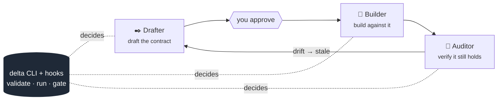

<div align="center">

# Delta

**A verifiable contract between what your project says it does and what its code does.**

[](https://claude.com/claude-code)
[]()
[]()

</div>

---

Most project context lives in one of two bad places: a person's head, or an ever-growing history of decisions that costs more to read than it's worth. **Delta** treats documentation as a set of **living contracts** instead: files that describe what is true *right now*, edited in place as things change, never appended to as a log. Superseded content is simply gone; git history is already the record of what used to be true.

What Delta adds on top is that the contract can be **checked**. Every claim has a stable ID and says how it is verified, the code the agent writes is held to the contract, and when the code and the contract drift apart, you find out instead of the agent silently believing a stale document.

> **Status: redesign in progress.** Delta is moving from a prompt-only methodology to a small deterministic CLI (`delta`, written in Go) plus Claude Code hooks, with three skills on top. The CLI is partly built: `spec new|lint|write`, `link`, `lint`, `check`, `status`, `hook` (including the lint and Stop checks), `budget`, `version` and `init` work; the rest is planned. [`agents/`](agents) holds the skills and rules that `delta init` installs; this repo does not version a `.claude/` of its own. The design and the order of work are in [`docs/`](docs).

## Contents

- [The idea](#the-idea)
- [Three roles and a CLI](#three-roles-and-a-cli)
- [What a contract looks like](#what-a-contract-looks-like)
- [What the knowledge base looks like](#what-the-knowledge-base-looks-like)
- [Rules](#rules)
- [What Delta promises, and what it doesn't](#what-delta-promises-and-what-it-doesnt)
- [Using this repo today](#using-this-repo-today)
- [Repository layout](#repository-layout)
- [Non-goals](#non-goals)
- [Acknowledgments](#acknowledgments)

---

## The idea

**The model proposes, the code decides.** Everything that can be a rule (the shape of a spec, the state of a feature, whether a claim holds) is enforced by a program and hooks, not by a prompt that the model may or may not follow. The model is kept for what is genuinely creative or ambiguous: interviewing, drafting claims, planning, writing code.

- **One contract per feature.** Each feature (a *slice*) gets a short spec that says what it must do and what must always be true. It describes the present, not the history.
- **Claims are checkable.** Every claim has an ID and a verification tag. `delta check` runs the linked command and reports `Holds`, `Violated` or `Unverified`. `Unverified` never pretends to be `Holds`.
- **The contract drives the code.** Tests cite the claim they prove, and when the code would have to contradict a claim, the agent stops and raises a spec question instead of deciding silently.
- **Drift is loud.** When code a contract references changes, the slice is marked `stale` until it is verified again.
- **You decide at the expensive points.** The plan is yours to approve before anything is built, and nothing in the knowledge base is changed behind your back.

## Three roles and a CLI



| Role | What it does | Slice state it owns |
|---|---|---|
| ✒️ **Drafter** | Interviews you about one feature, investigates the real code and drafts the claims | up to `draft`; you move it to `approved` |
| 🔨 **Builder** | Plans from the claims not yet verified, you approve the plan, then it writes tests first and the code. Never edits the contract | `approved` → `built` |
| 🔏 **Auditor** | Verifies the contract against the code. The deterministic part runs commands; a model reads only what has no command | `built` → `verified`, or back to `stale` |

The `delta` CLI is what makes the state machine real: it validates specs, is the only writer of the knowledge base, runs verification, tracks drift, measures the context budget, and answers the Claude Code hooks. It does not depend on Claude Code; the hooks are a thin adapter on top. Working today: `spec new|lint|write`, `link`, `lint`, `check`, `status`, `hook`, `budget`, `version` and `init`. Planned: `approve`, `stale` and `context`.

## What a contract looks like

```markdown
---
format: 1
slice: invoicing
status: approved
---

## Invariants
- INV-01 [test: go test ./invoicing]
  When an invoice is issued, the system shall round each line to 2 decimals before summing.
- INV-02 [none]
  The system shall not issue two invoices with the same sequence number.
```

Tags are `test: <command>` (any command that exits 0 when the claim holds, unit or end-to-end), `manual` and `none`. A `none` claim is valid but stays visible in `delta status` as verification debt, so you can start without a test harness and add it where it pays.

A slice is a bounded feature or capability, sized the way a bounded context would be, not a source file and never an architecture layer. Two contracts that keep changing together for the same reason are really one slice wearing two names.

## What the knowledge base looks like

A project's knowledge base has three layers: a router, a curated reference, and per-feature contracts.

```
CLAUDE.md                          router — orients a session fast, points at everything else
.claude/docs/                      curated reference, created on demand and only if it holds what the code doesn't show
.claude/rules/<topic>.md           conventions loaded when matching files are touched
deltas/specs/<slice>.spec.md  per-feature living contracts ("slices")
```

Docs and rules stay self-contained and free of volatile references (no citing a specific file path or function as proof a convention exists), since that breaks the moment something is renamed. A spec, by contrast, is expected to name the real implementation, since that is the point of a contract checked against it.

## Rules

Every rule that ships is installed and used; there are no presets. Each name says what the rule governs:

- **Always loaded.** `claims-fidelity` (the contract is the scope, tests cite the claim they prove, and ambiguity goes back to the spec), `done-needs-proof` (nothing is called done without evidence that the checks ran, and the closing says what was left unverified), `project-language` (talk in the person's language, keep everything the project stores in English) and `commit-messages` (how a commit is written).
- **Loaded when the files they govern are touched.** `code-change-scope` (a ladder of cheaper answers before writing new code) and `code-reliability` (never cut validation, error handling or security) for source files; `when-write-delta`, `kb-deltas-routing` and `context-budgets` for the knowledge base. This is where "better code" lives. It is a side effect of Delta, not what it promises.

Whatever a linter can check goes to a linter, not to a rule. Commit messages are a rule too: no hook checks them.

## What Delta promises, and what it doesn't

- **Promised: reliability of the system.** The CLI validates, states are respected, drift is detected. This is tested with ordinary tests, with no model involved.
- **Not promised yet: better results.** Whether an agent writes better code with Delta has not been measured. Delta does not claim token savings either: more orientation costs tokens, and the saving is a hypothesis.
- **Gates detect, they don't guarantee.** A `Holds` means the command exited 0 and a test cites the claim's ID, not that the test ran or is a good test. Drift detection is by referenced file, which is a heuristic: a slice depends on the code its test commands name (`go test ./billing` means `billing/`), and on every code file when a command names no path. The honest promise is "problems don't go unnoticed", not "there are no problems".

## Using this repo today

Build the CLI (`go install ./delta`, or `go build -ldflags "-X main.version=1.2.3" -o delta ./delta` to set the version) and run `delta init` in a git repository. It installs, without replacing anything the project already has:

- the skills and rules under `.claude/`, and Delta's hooks and permissions merged into `.claude/settings.json`;
- `deltas/budget.conf` and `deltas/testing.conf`, a minimal `CLAUDE.md` and the `deltas/specs/` folder.

After upgrading the `delta` binary, run `delta update` to bring those files up to date: it replaces the ones you have not touched, removes those the harness no longer ships, and keeps your changes (`delta update --check` only lists what would change).

Then:

1. *"let's spec out `<feature>`"* → Drafter interviews you and writes `<slice>.spec.md`.
2. *"implement `<feature>`"* → Builder plans from the unverified claims, then builds.
3. *"check `<feature>` for drift"* → Auditor verifies the contract against the code.

## Repository layout

| Path | Purpose |
|---|---|
| `agents/` | What `delta init` installs, embedded in the binary: the skills Comper (it routes plain requests, and `/comper` says which skill is next), Drafter, Builder, Auditor and Scriber, the rules, the hook settings and the config files |
| `docs/` | Working documents, in Spanish: `direction.md` (what Delta becomes and why), `backstory.md` (context), `blueprint.md` (design of the Go CLI), `waypoints.md` (order of work) |
| `delta/`, `package/` | The Go CLI: `delta/` is the entrypoint that wires it, and `package/` holds the domain, the use cases, the gateways and the adapters (the command line and the hook) |

## Non-goals

- Delta does not keep an append-only decision log. When two sources disagree, the conflict is resolved explicitly and the resolution becomes the corrected text.
- Delta does not replace ordinary coding with no spec behind it. Builder writes application code only from a plan you approved and derived from a spec, and never touches the knowledge base.
- Delta does not audit docs or rules for drift; it checks a slice's contract against the code.
- Delta is not a process to follow phase by phase. The product is the verified contract, not the workflow around it.

## Acknowledgments

The lean-change ladder in the `code-change-scope` rule is adapted from [ponytail](https://ponytail.dev/) (MIT), and the idea that every rule must earn its place against the version without it comes from the same project. Spec Kit and OpenSpec shaped the spec-first flow Delta deliberately keeps small.
