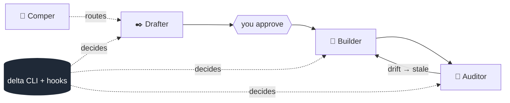

<div align="center">

# Delta

**Contracts for your code that can actually be checked.**

[](https://claude.com/claude-code)
[]()
[]()

</div>

## What is Delta?

Delta keeps a short **contract** for each feature of your project: what it must do and what must always be true. Each claim in the contract says how it is verified, and Delta checks it against the code. When the code and the contract drift apart, you find out.

It is three things working together:

- a small **CLI** (`delta`, written in Go) that validates, tracks state and runs checks;
- **hooks** that plug it into Claude Code;
- **five skills** that do the creative work: interviewing, drafting, planning and building.

The contracts describe what is true *now* and are edited in place. There is no decision log; git already records what used to be true.

## How you use it

1. You ask for a feature: *"add refunds to billing"*.
2. **Drafter** interviews you and writes the contract.
3. **You approve it.**
4. **Builder** plans, you OK the plan, then it writes tests first and the code.
5. `delta check` runs the claims and marks the feature `verified`.
6. If the code changes later, the feature becomes `stale` until it is checked again.

Setup, commands and troubleshooting are in **[INSTRUCTIONS.md](INSTRUCTIONS.md)**.

## The five skills

| Skill | Job |
|---|---|
| 🧭 `/comper` | Says which skill comes next, and routes plain requests |
| ✒️ `/drafter` | Interviews you and drafts the contract |
| 🔨 `/builder` | Builds the feature against the approved contract |
| 🔏 `/auditor` | Verifies the contract still holds. Reports, never edits |
| 📖 `/scriber` | Writes the four docs for people. Outside the contract loop |



## What a contract looks like

```markdown
---
format: 1
slice: invoicing
status: approved
---

# invoicing: spec

## Intent
Issue invoices that add up exactly.

## Invariants
- INV-01 [test: go test ./invoicing]
  When an invoice is issued, the system shall round each line to 2 decimals before summing.
- INV-02 [none]
  The system shall not issue two invoices with the same sequence number.

## Acceptance criteria
- ACC-01 [manual: issue an invoice from the admin screen]
  Given a customer with two orders, when the invoice is issued, then it lists both.
```

Each claim has a stable ID and a tag:

- `test: <command>`: a command that exits 0 when the claim holds.
- `manual`: only a person can check it.
- `none`: not verified yet. Valid, and shown as debt.

`delta check` reports each claim as **Holds**, **Violated** or **Unverified**. Unverified never passes for Holds.

## The life of a feature

```
draft ──approve──▶ approved ──built──▶ built ──check──▶ verified
                       ▲                                    │
                       └──── rebuild / revise ◀── stale ◀───┘
                                                  (code changed)
```

| State | Meaning |
|---|---|
| `draft` | Written, waiting for your review |
| `approved` | Accepted; ready to build |
| `built` | Code and tests exist |
| `verified` | Every test claim held in the last check |
| `stale` | The code changed since; the contract may be out of date |

## Principles

- **The model proposes, the code decides.** Rules live in the CLI and hooks, not in prompts. The model handles what is ambiguous.
- **You decide at the expensive points.** You approve the contract and the plan. Nothing in the knowledge base changes behind your back.
- **Drift is loud.** Changed code marks its contract stale instead of leaving a document that quietly lies.
- **Ambiguity goes back to the spec.** If the code would have to contradict a claim, the agent stops and asks.

## What Delta promises, and what it doesn't

**It promises** a reliable system: the CLI validates, states are respected and drift is detected. This is covered by ordinary tests with no model involved.

**It does not promise** better code or fewer tokens. Neither has been measured.

**Its checks detect, they don't guarantee.** `Holds` means the command exited 0 and a test cites the claim's ID, not that the test is a good one. Drift follows the files a test command names, so a change in a package it only imports goes unnoticed. The honest promise is "problems don't go unnoticed", not "there are no problems".

## Non-goals

- No append-only decision log.
- No replacement for ordinary coding with no spec behind it.
- No audit of docs or rules for drift; Delta checks contracts against code.
- Not a phase-by-phase process. The product is the verified contract.

## Reference

<details>
<summary><b>What <code>delta init</code> installs</b></summary>

```
CLAUDE.md                         router: orients a session and says how to work
.claude/skills/<skill>/SKILL.md   the five skills
.claude/rules/<rule>.md           conventions, loaded when they apply
.claude/settings.json             hooks and permissions, merged with yours
deltas/specs/<slice>.spec.md      one contract per feature
deltas/docs/<doc>.md              four docs for people
deltas/budget.conf                ceilings for always-loaded context
deltas/testing.conf               what counts as a test file
deltas/deltas.manifest            what delta installed, for `delta update`
```

The agent cannot edit `CLAUDE.md`, `.claude/docs|rules|agents|skills/` or the files directly under `deltas/`. A hook blocks it and the CLI is the way in. A person can edit them by hand.

</details>

<details>
<summary><b>Hooks</b></summary>

All five events run the same command, `delta hook`.

| Event | What Delta does |
|---|---|
| `SessionStart` | Reports where every slice stands and what is wrong with the setup |
| `UserPromptSubmit` | Adds the next step of each slice to every message |
| `PreToolUse` on `Write`/`Edit` | Blocks edits to the knowledge base |
| `PostToolUse` on `Write`/`Edit` | Reports newly stale slices and lints a test file as soon as it is written |
| `Stop` | Asks once for `delta check` if claims were not checked against the current code |

A broken delta never stops the agent. Only an explicit block does.

</details>

<details>
<summary><b>Commands</b></summary>

| Command | What it does |
|---|---|
| `delta init` / `update [--check]` | Install the harness / bring it up to date |
| `delta status` | Every slice, its state and claims, docs progress, setup warnings |
| `delta spec new\|lint\|write` | Create, check or save a spec |
| `delta lint` | Check every spec and cross it with the project's tests |
| `delta approve <slice>` | Approve a draft. For a person to run |
| `delta ready` / `built <slice>` | Gate and record the build |
| `delta link <slice> <id> "<cmd>"` | Set a claim's tag to `test: <cmd>` |
| `delta check [slice]` | Run every test claim |
| `delta stale` | Mark verified slices stale when their code changed |
| `delta budget` | Weigh always-loaded context against its ceilings |
| `delta hook` / `version` | Answer a hook event / print the version |

Exit `0` is fine, `1` means problems were found, `2` is an error. Findings go to stderr, results to stdout.

</details>

<details>
<summary><b>Rules</b></summary>

Always loaded: `claims-fidelity`, `done-needs-proof`, `project-language`, `commit-messages`.

Loaded when the files they govern are touched: `code-change-scope` and `code-reliability` for source files; `when-write-delta`, `kb-deltas-routing` and `context-budgets` for the knowledge base.

Whatever a linter can check goes to a linter, not to a rule.

</details>

<details>
<summary><b>Repository layout</b></summary>

| Path | Purpose |
|---|---|
| `agents/` | What `delta init` installs, embedded in the binary |
| `deltas/` | CLI entrypoint; its tests drive the whole CLI |
| `package/domain` | The rules, with no input or output |
| `package/usecase` | What each command does |
| `package/gateway` | The outside world: files, git, commands, check record |
| `package/adapter` | The ways in: command line and hook events |

</details>

## Development

```
go vet ./...
go test ./...
go build -o dist/delta ./deltas
go build -ldflags "-X main.version=1.2.3" -o dist/delta ./deltas   # with a version
```

The binary must be called `delta` (hooks, permissions and the PATH check depend on it), so use the build above instead of `go install ./deltas`, and put `dist/delta` on your `PATH`. Tests need `git`; the TypeScript compatibility test needs a `node` that runs TypeScript and is skipped without one.

## Acknowledgments

The lean-change ladder in the `code-change-scope` rule is adapted from [ponytail](https://ponytail.dev/) (MIT). Spec Kit and OpenSpec shaped the spec-first flow Delta deliberately keeps small.
