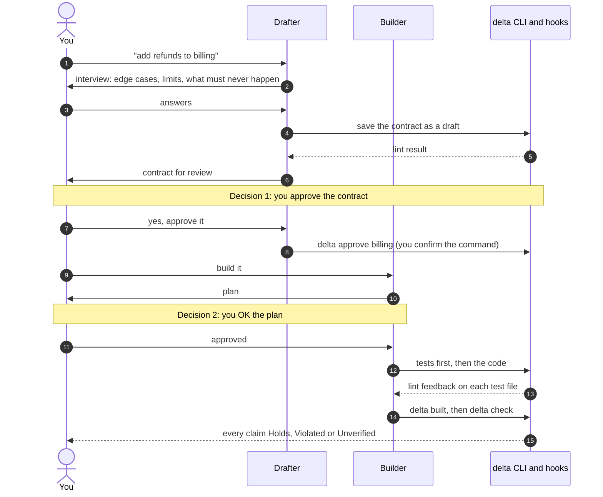
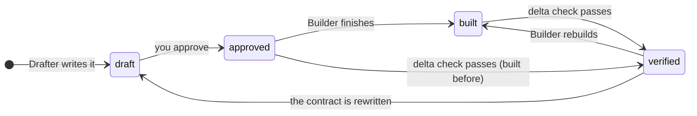

<div align="center">

# Delta

**Contracts for your code that can actually be checked.**

[](https://claude.com/claude-code)
[](#the-five-skills)
[](#development)

[Install](#install) · [Why](#why-delta) · [How it works](#how-it-works) · [Walkthrough](#a-walkthrough) · [Contract format](#what-a-contract-looks-like) · [Reference](#reference) · [User manual](MANUAL.md)

</div>

---

## What is Delta?

Delta keeps a short **contract** for each feature of your project: what it must do and what must always be true. Every claim in the contract says how it is verified, and Delta checks it against the code. When code and contract drift apart, you find out.

It is three pieces working together:

| Piece | What it does |
|---|---|
| **CLI** (`delta`, in Go) | Validates contracts, tracks the state of each feature and runs the checks |
| **Hooks** | Plug the CLI into Claude Code so the rules are enforced, not merely suggested |
| **Five skills** | Do the creative work: interview you, draft, plan, build and audit |

Contracts describe what is true *now* and are edited in place. There is no decision log; git already records what used to be true.

## Install

You do not need Go. The installer downloads the latest release, verifies its checksum and puts `delta` on your `PATH`.

**Linux and macOS**

```sh
curl -fsSL https://raw.githubusercontent.com/ronz204/deltas-ai/main/install.sh | sh
```

**Windows (PowerShell)**

```powershell
irm https://raw.githubusercontent.com/ronz204/deltas-ai/main/install.ps1 | iex
```

Then check it with `delta version` and run `delta init` inside your project. The [manual](MANUAL.md#install-the-cli) covers manual downloads, updating and building from source.

## Why Delta?

Working with a coding agent, the same thing keeps happening. You ask for a feature, the agent builds it, and a few sessions later nobody can say what that feature was supposed to guarantee. The intent lived in a chat that is gone. The tests, if any, check whatever the agent happened to think of. Documentation, if it exists, was accurate on the day it was written.

Delta tackles that in three moves:

1. **Write the promise down first.** Before any code, a short contract states what the feature must do. You read it and approve it, so the cheapest place to fix a misunderstanding is also the first place you look.
2. **Tie every claim to a check.** A claim is not just a sentence. It carries a tag that says how it is verified: a command that must pass, a step a person performs, or an honest "not yet".
3. **Notice when the promise may be stale.** When code a contract depends on changes, Delta shows it and asks for a check before anyone trusts the contract again. A document that quietly lies is worse than no document, so Delta makes the drift visible.

The model does what models are good at: asking the right questions, drafting, planning and writing code. Everything that has a right answer, such as validating a contract, enforcing a state or deciding whether a command passed, is done by ordinary code that tests can cover.

## How it works

Delta works in two lanes, chosen by what you ask for.

- **A request that changes what a feature promises** (new behavior, or a guarantee that is different) goes through the contract lane below. You make decisions at the two points where a mistake is most expensive: the contract and the plan.
- **Anything else** (a bug fix, a refactor, a tweak, a dependency) is ordinary work: the agent just does it. When it tries to finish, Delta asks it to run `delta check` on the slices whose code it touched. If they hold, nothing else happens and no contract was touched. If a claim fails, the agent fixes the code, or tells you the promise itself changed.

A small change to a promise of a slice that was already built, such as a limit going from 45 to 60 days, is an *amendment*: no interview, only the before and after of that claim, and no rebuild if its tests still hold.



The agent never decides on its own that something is done. `delta check` runs the claims, and the result is what moves a feature to `verified`. If the code would have to contradict a claim, the agent stops and asks instead of bending the contract.

### The life of a feature

Every feature, which Delta calls a *slice*, is always in exactly one state. The CLI enforces the moves between states, so a skill cannot skip one.



| State | Meaning | Moves on when |
|---|---|---|
| `draft` | Written, waiting for your review | You approve it |
| `approved` | Accepted and ready to build | Builder records the build with `delta built`; or `delta check` passes, if it was built before |
| `built` | Code and tests exist | `delta check` passes |
| `verified` | Every test claim held in the last check | The contract is rewritten, or Builder rebuilds it |

Drift is not a state. When the code a slice depends on changes, the slice stays `verified` and `delta status` shows it as `verified (2 files changed)`: "this was true when it was last checked, and something has changed since". Nothing in the contract is rewritten. `delta check` confirms it still holds and clears the note. Specs written by an older Delta may say `stale`; a passing check brings them back to `verified`.

Rewriting an `approved`, `built` or `verified` contract sends it back to `draft` and needs a new approval.

### The five skills

Skills are the parts of the workflow that need judgment. Each one has a narrow job and a clear edge, so none of them quietly does the work of another.

| Skill | Job |
|---|---|
| 🧭 `/comper` | Says which skill comes next and routes plain requests, so you do not have to remember the order |
| ✒️ `/drafter` | Interviews you and drafts the contract. It asks before it assumes |
| 🔨 `/builder` | Plans, then builds the feature against the approved contract, tests first |
| 🔏 `/auditor` | Verifies that the contract still holds. It reports and never edits |
| 📖 `/scriber` | Writes the four docs for people. It sits outside the contract loop |

### Who does what

You will almost never type a `delta` command. You talk to the agent in plain words and make two decisions; the agent and the hooks do the rest.

| | You | The agent | The hooks |
|---|---|---|---|
| Ask for features and answer questions | ✅ | | |
| Read and approve the contract | ✅ | | |
| Approve the plan | ✅ | | |
| Write the contract, tests and code | | ✅ | |
| Run `delta spec write`, `link`, `built`, `check` | | ✅ | |
| Run `delta approve` | confirm it | runs it after your yes | |
| Report drift, block edits, remind it to check | | | ✅ |

### How the agent knows what to do

Nothing is left to memory. Four layers, all installed by `delta init`, tell the agent what to do and when:

1. **`CLAUDE.md`** is read at the start of every session. It holds a small table: no spec means `/drafter`, a draft needs your approval, approved means `/builder`, built means `/auditor`, and a bug fix or a refactor needs no skill.
2. **The skills** (`.claude/skills/<skill>/SKILL.md`) are the manual for each role, including the exact `delta` commands it runs and in which order.
3. **The rules** (`.claude/rules/`) are conventions that load by themselves when they apply, such as "nothing is done until the checks ran".
4. **The hooks** tell the agent where every slice stands at session start, add one line to every message that sets the two lanes apart, and ask for a check when it is about to finish after touching a slice's code.

## A walkthrough

Here is a first feature from start to finish. It is an illustration: the agent's exact words will differ, but the order of the steps and who decides at each one will not.

First, install the harness in your project, once:

```bash
delta init
```

Then open Claude Code and talk.

**1. You ask**

> 👤 **You:** add refunds to billing

**2. Drafter interviews you.** It reads the code first, then asks what the code cannot tell it.

> 🤖 **Drafter:** A few questions. Are partial refunds allowed? Is there a time limit? Does the original charge stay untouched?
>
> 👤 **You:** Partial refunds yes, 30 days maximum, and the original charge is never touched.

**3. You review the contract.** Drafter saves `deltas/specs/billing.spec.md` as a `draft` and summarizes its claims, saying which ones have no test yet.

> 👤 **You:** (reads the file) Make it 45 days.
>
> 🤖 **Drafter:** Done. Do you approve this contract?
>
> 👤 **You:** Yes.

Claude Code shows `delta approve billing` and asks you to confirm it. Approving is always your decision, never the agent's.

**4. Builder plans, you OK the plan.**

> 🤖 **Builder:** My plan: a test for each claim citing its ID, then `billing/refund.go`, then link every claim to `go test ./billing`. Shall I go ahead?
>
> 👤 **You:** Go ahead.

**5. Builder builds and verifies.** It writes each test first, and a hook lints every test file as it is saved. Then it writes the code and runs `delta link`, `delta built billing` and `delta check billing`.

> 🤖 **Builder:** All three claims hold. `billing` is `verified`.

**6. Weeks later, a bug.** You ask the agent to fix a rounding error in `billing/refund.go`. That keeps every promise, so it just fixes it. When it tries to finish, the `Stop` hook asks it once to run `delta check billing`, because it touched code of that slice. Every claim holds, `billing` stays `verified`, and the contract was never touched.

**7. A promise changes.** You ask for refunds up to 60 days, not 45. Drafter does not interview you again: it shows the before and after of `INV-02` and you approve it. The agent runs `delta check billing`; the test still holds, so `billing` is `verified` again with no rebuild.

At any point, `delta status` shows every slice and its state, and `/comper` tells you which skill comes next. For the same session in more detail, see the [full example in the manual](MANUAL.md#a-full-example-session).

## What a contract looks like

A contract is a plain Markdown file with a small amount of structure. It is meant to be read by a person in under a minute.

```markdown
---
format: 1
slice: invoicing
status: approved
---

# invoicing: spec

## Intent
Issue invoices that add up exactly.

## Invariants
- INV-01 [test: go test ./invoicing]
  When an invoice is issued, the system shall round each line to 2 decimals before summing.
- INV-02 [none]
  The system shall not issue two invoices with the same sequence number.

## Acceptance criteria
- ACC-01 [manual: issue an invoice from the admin screen]
  Given a customer with two orders, when the invoice is issued, then it lists both.
```

The **Intent** says why the feature exists in a sentence or two. **Invariants** are things that must always be true. **Acceptance criteria** describe what a user should be able to do. Each claim is one rule with one ID, so a test, a report or a conversation can point at exactly `INV-01` and mean the same thing every time.

The tag in brackets says how the claim is verified:

| Tag | Meaning |
|---|---|
| `test: <command>` | A command that exits 0 when the claim holds. This is what `delta check` runs |
| `manual` | Only a person can check it, such as a look at an admin screen |
| `none` | Not verified yet. This is valid, and it is shown as debt rather than hidden |

`delta check` reports each claim as **Holds**, **Violated** or **Unverified**. Unverified never passes for Holds: a claim nobody checked is not a claim that held.

## Principles

- **The model proposes, the code decides.** Rules live in the CLI and hooks, not in prompts. A prompt can be ignored; a hook that blocks an edit cannot. The model handles what is ambiguous.
- **You decide at the expensive points.** You approve the contract and the plan. Nothing in the knowledge base changes behind your back.
- **Drift is visible.** Changed code shows next to its contract and a check is asked for, instead of leaving a document that quietly lies.
- **Ambiguity goes back to the spec.** If the code would have to contradict a claim, the agent stops and asks. The fix is a conversation about the contract, not a silent workaround.

## What Delta promises, and what it doesn't

Being clear about the limits matters more here than in most tools, because the whole point is trust.

- ✅ **It promises a reliable system.** The CLI validates, states are respected and drift is detected. This is covered by ordinary tests with no model involved.
- ❌ **It does not promise better code or fewer tokens.** Neither has been measured, so neither is claimed.
- ⚠️ **Its checks detect, they don't guarantee.** `Holds` means the command exited 0 and a test cites the claim's ID. It does not mean the test is a good one. Drift follows the files each build changed (or the paths a test command names), so a change in code a slice only imports goes unnoticed.

The honest promise is "problems don't go unnoticed", not "there are no problems".

### Non-goals

- No append-only decision log. Contracts are edited in place and git keeps the history.
- No replacement for ordinary coding with no spec behind it. Small fixes do not need a contract.
- No audit of docs or rules for drift. Delta checks contracts against code, nothing else.
- Not a phase-by-phase process. The product is the verified contract, not a ceremony around it.

---

## Reference

### What `delta init` installs

`delta init` copies the harness into your project. Everything it installs is embedded in the binary, so it works offline, and `deltas/deltas.manifest` remembers what was installed so `delta update` can bring it up to date without touching your own files.

```text
CLAUDE.md                         router: orients a session and says how to work
.claude/skills/<skill>/SKILL.md   the five skills
.claude/rules/<rule>.md           conventions, loaded when they apply
.claude/settings.json             hooks and permissions, merged with yours
deltas/specs/<slice>.spec.md      one contract per feature
deltas/docs/<doc>.md              four docs for people
deltas/budget.conf                ceilings for always-loaded context
deltas/testing.conf               what counts as a test file, and what never counts as code
deltas/deltas.manifest            what delta installed, for `delta update`
```

The agent cannot edit `CLAUDE.md`, `.claude/docs|rules|agents|skills/` or the files directly under `deltas/`. A hook blocks it and the CLI is the way in. A person can edit them by hand. This keeps the knowledge base from drifting just because a model decided to tidy it.

### Commands

You rarely type these: the skills run them for you. The ones worth knowing by hand are `status`, `check`, `lint` and `update`. Commands fall into four groups. Exit code `0` means all is fine, `1` means problems were found, and `2` means an error. Findings go to stderr and results to stdout, so the output is safe to pipe.

**Set up and maintain**

| Command | What it does |
|---|---|
| `delta init` | Install the harness into the current project |
| `delta update [--check]` | Bring the installed harness up to date. With `--check`, only report what would change |
| `delta status` | Show every slice, its state and claims, docs progress and setup warnings |
| `delta budget` | Weigh the always-loaded context against its ceilings |
| `delta version` | Print the version |

**Write contracts**

| Command | What it does |
|---|---|
| `delta spec new` | Create a new spec from the template |
| `delta spec lint` | Check one spec for structure and wording |
| `delta spec write` | Save a spec after validating it |
| `delta lint` | Check every spec and cross it with the project's tests |
| `delta approve <slice>` | Approve a draft. The agent runs it only after your yes, and you confirm it |

**Build and verify**

| Command | What it does |
|---|---|
| `delta ready <slice>` | Gate the build (any contract that is not a draft passes) and start following it |
| `delta built <slice>` | Record that the build is done, and the files it changed as the slice's footprint |
| `delta link <slice> <id> "<cmd>"` | Set a claim's tag to `test: <cmd>` |
| `delta check [slice...]` | Run every test claim and record the result |
| `delta stale` | List verified slices whose code changed since they were verified (read-only) |

**Integrate**

| Command | What it does |
|---|---|
| `delta hook` | Answer a Claude Code hook event. Called by the hooks, rarely by hand |

### Hooks

All five events run the same command, `delta hook`. Keeping a single entry point means the behaviour is tested in one place.

| Event | What Delta does |
|---|---|
| `SessionStart` | Reports where every slice stands, with its next step, and what is wrong with the setup, so a new session starts oriented. It also remembers the state of the project, to know later what this session changed |
| `UserPromptSubmit` | Adds one fixed line to every message: a change to what a feature promises goes through `comper`, anything else is ordinary work |
| `PreToolUse` on `Write`/`Edit` | Blocks edits to the knowledge base, which only the CLI may change |
| `PostToolUse` on `Write`/`Edit` | Lints a test file as soon as it is written |
| `Stop` | Asks once for `delta check` of the slices whose code this session touched, and holds the agent back if a claim is violated. Slices not built yet never hold it back |

A broken delta never stops the agent. If the CLI fails or the setup is incomplete, the hook reports it and lets the session carry on. Only an explicit block does.

### Rules

Rules are short conventions the agent follows. They are loaded by relevance rather than all at once, which keeps the always-loaded context small, and `delta budget` measures it against ceilings you can configure.

| Loaded | Rules |
|---|---|
| Always | `claims-fidelity`, `done-needs-proof`, `project-language`, `commit-messages` |
| When source files are touched | `code-change-scope`, `code-reliability` |
| When the knowledge base is touched | `when-write-delta`, `kb-deltas-routing`, `context-budgets` |

Whatever a linter can check goes to a linter, not to a rule. A rule is only worth its tokens when no tool can enforce it.

### Repository layout

The code is split in layers so the rules can be tested without a terminal, a disk or a model.

| Path | Purpose |
|---|---|
| `agents/` | What `delta init` installs, embedded in the binary |
| `cmd/delta/` | CLI entrypoint. Its tests drive the whole CLI |
| `package/domain` | The rules, with no input or output |
| `package/usecase` | What each command does |
| `package/gateway` | The outside world: files, git, commands and the check record |
| `package/adapter` | The ways in: the command line and hook events |

---

## Development

```bash
go vet ./...
golangci-lint run ./...
go test ./...
go build -o dist/delta ./cmd/delta
go build -ldflags "-X main.version=1.2.3" -o dist/delta ./cmd/delta   # with a version
```

The binary must be called `delta`, because hooks, permissions and the PATH check depend on it. The entrypoint lives in `cmd/delta`, so both the build above and `go install ./cmd/delta` produce a binary with that name. Put it on your `PATH`. Releases are built with [GoReleaser](https://goreleaser.com); [RELEASE.md](RELEASE.md) explains how to cut one.

Tests need `git`. The TypeScript compatibility test needs a `node` that runs TypeScript and is skipped without one.

For setup, day-to-day use and troubleshooting, see the **[user manual](MANUAL.md)**.
